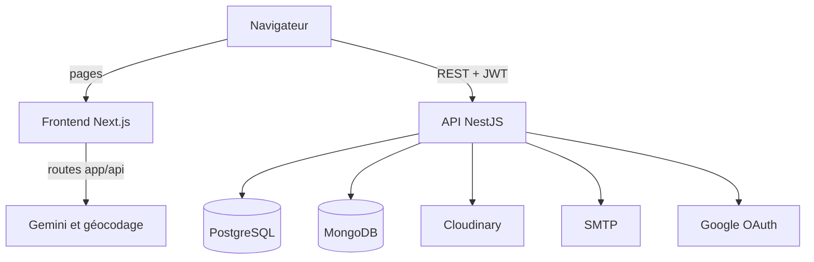

# Architecture d'Éco-Voyage

Ce document décrit la conception de la plateforme, les décisions techniques, le workflow jusqu'à la production et les limites connues.

## 1. Vue d'ensemble

Éco-Voyage relie des éco-voyageurs à des professionnels du tourisme durable : guides, prestataires et porteurs de projet. Elle couvre les offres et les circuits, les réservations individuelles et de groupe, les disponibilités, la collaboration entre professionnels, la messagerie, le contenu social et la validation par un administrateur.

## 2. System design



- Le navigateur appelle directement l'API. Son adresse est fixée au build par `NEXT_PUBLIC_API_URL`.
- L'API est le seul composant applicatif qui accède aux bases de données.
- Quelques routes Next.js (`app/api`) s'exécutent côté serveur pour le géocodage et la suggestion de tags avec Gemini, ce qui garde la clé Gemini hors du navigateur.
- En production, le frontend, l'API et les deux bases tournent dans des conteneurs Docker sur un seul VPS. Ce VPS est donc un point de panne unique.

### Organisation de l'API

L'API est découpée en 23 modules fonctionnels, regroupés ici par domaine :

| Domaine | Modules |
|---|---|
| Comptes | `auth`, `users`, `eco-traveler`, `guide`, `provider`, `provider-activity`, `project-owner`, `organization`, `questionnaire` |
| Offres et réservations | `offer`, `circuit`, `reservation` |
| Social | `publication`, `interactions`, `follow`, `messages`, `notifications`, `place-contribution` |
| Modération | `admin`, `reports`, `badge` |
| Techniques | `mail`, `upload` |

Les règles communes sont appliquées globalement dans `main.ts` et `app.module.ts` :

- `JwtAuthGuard` et `RolesGuard` protègent les routes ;
- `ValidationPipe` rejette les champs non déclarés dans les DTO ;
- un limiteur autorise 100 requêtes par minute ;
- une tâche planifiée horaire traite les profils rejetés dont le délai est dépassé.

### Authentification

La connexion se fait par e-mail et mot de passe, ou avec Google. L'API renvoie un JWT d'accès (2 jours par défaut) et un refresh token valable 7 jours. Le frontend les stocke dans `localStorage` et renouvelle le JWT automatiquement (`lib/api.ts`).

### Données

| Base | Contenu | Accès |
|---|---|---|
| PostgreSQL | Comptes, offres, sessions, circuits, réservations, conversations, publications, notifications | 32 entités TypeORM |
| MongoDB | Préférences et engagement des voyageurs, compétences et engagement des guides, détail des activités, services et engagement des projets | 7 schémas Mongoose |

Les documents MongoDB référencent les utilisateurs PostgreSQL par `user_id`. Aucune contrainte ni transaction ne garantit la cohérence entre les deux bases : c'est le code applicatif qui en est responsable.

## 3. Décisions techniques

### Séparer le frontend et l'API
**Pourquoi :** chaque partie se développe et se déploie séparément, et l'API reste utilisable par un autre client.
**Limite :** deux applications à configurer et à déployer, avec la gestion du CORS.

### Découper l'API en modules NestJS
**Pourquoi :** le périmètre fonctionnel est large, et un module par domaine permet de travailler à plusieurs avec moins de conflits.
**Limite :** une seule application reste déployée. Ce n'est pas une architecture en microservices, et un module ne peut pas monter en charge seul.

### Utiliser PostgreSQL et MongoDB
**Pourquoi :** les réservations et les offres ont besoin de relations et d'intégrité, alors que les réponses aux questionnaires varient selon le profil et évoluent souvent.
**Limite :** deux bases à exploiter et à sauvegarder, sans cohérence garantie entre elles. Les colonnes JSONB de PostgreSQL auraient pu suffire.

### Messagerie en REST avec polling
**Pourquoi :** c'est simple à mettre en place et à déployer, sans connexion permanente à gérer. Le frontend recharge la conversation ouverte toutes les 5 secondes.
**Limite :** un délai d'affichage et des requêtes inutiles. Les WebSockets deviendraient préférables avec plus d'utilisateurs.

### `synchronize: true` dans TypeORM
**Pourquoi :** le schéma suit les entités sans effort, ce qui a permis d'itérer vite pendant le développement.
**Limite :** c'est risqué en production, car un changement d'entité modifie le schéma au démarrage et peut supprimer des données. C'est la première décision à corriger.

### Docker Compose sur un VPS
**Pourquoi :** le même serveur héberge plusieurs projets, et Compose suffit pour un seul serveur sans trafic réel.
**Limite :** pas de haute disponibilité ni de déploiement sans interruption.

## 4. Workflow, du développement à la production

### Environnements

| Environnement | Où | Configuration |
|---|---|---|
| Développement | Machine du développeur, bases dans `docker-compose.local.yml` | `.env.dev`, `.env.local` |
| Staging | Aucun | |
| Production | VPS, avec Docker Compose | `.env.production` |

### Développement

Le travail se fait sur une branche par fonctionnalité, puis passe par une pull request vers `main`. Aucune vérification n'est automatisée : `yarn dev` ne vérifie pas les types, et seul `yarn build` détecte certaines erreurs.

### Déploiement

Le déploiement est manuel, et le dossier du serveur n'est pas un dépôt Git. Le dernier déploiement a suivi ces étapes :

1. Vérifier en local le build de production de l'API et du frontend.
2. Sauvegarder le code et PostgreSQL sur le serveur :
   ```bash
   tar czf sauvegardes/code-$(date +%F).tgz backend frontend
   docker compose exec -T db sh -c 'pg_dump -U "$POSTGRES_USER" "$POSTGRES_DB"' > sauvegardes/postgres-$(date +%F).sql
   ```
3. Envoyer le code avec `rsync`, en excluant `node_modules`, les builds et les fichiers `.env*`.
4. Reconstruire et redémarrer :
   ```bash
   docker compose up -d --build api web
   ```
5. Contrôler les pages et l'API.

Les images sont construites sur le serveur avec des Dockerfiles multi-stage. Le frontend utilise le mode `standalone` de Next.js.

La configuration réelle du serveur n'est pas entièrement versionnée : son `docker-compose.yml` diffère de celui du dépôt, notamment pour les ports.

## 5. Limites connues

| Sujet | État actuel | Risque |
|---|---|---|
| CI/CD | Aucune | Une erreur de build n'apparaît qu'au moment de déployer |
| Staging et previews | Aucun | Une version part en production sans validation préalable |
| Migrations | `synchronize: true` | Modification non contrôlée du schéma en production |
| Tests | 6 fichiers unitaires et 1 test e2e, côté API seulement | Peu de protection contre les régressions |
| HTTPS | Le site est servi en HTTP | Les identifiants et les tokens circulent sans chiffrement |
| Tokens | Stockés dans `localStorage` | Exposés en cas de faille XSS |
| Sauvegardes | Manuelles, MongoDB non inclus dans la procédure ci-dessus | Perte de données possible |
| Disponibilité | Un seul VPS | Point de panne unique |
| Maintenabilité | `app/dashboard/page.tsx` dépasse 2 700 lignes | Difficile à faire évoluer et à tester |
| Configuration | Pas de fichier `.env.example`, configuration du serveur non versionnée | Installation et reprise du déploiement plus difficiles |

## 6. Prochaines étapes

Par ordre de priorité :

1. **CI avec GitHub Actions :** lint, tests et build à chaque pull request.
2. **Migrations TypeORM versionnées :** remplacer `synchronize: true` en production.
3. **HTTPS et domaine :** placer un reverse proxy devant le site et l'API.
4. **Déploiement reproductible :** versionner la configuration du serveur et publier des images depuis la CI.
5. **Staging :** valider chaque version de `main` avant la production.
6. **Sauvegardes automatiques :** PostgreSQL et MongoDB, avec un test de restauration.
7. **Tests :** couvrir d'abord les réservations et l'authentification.
